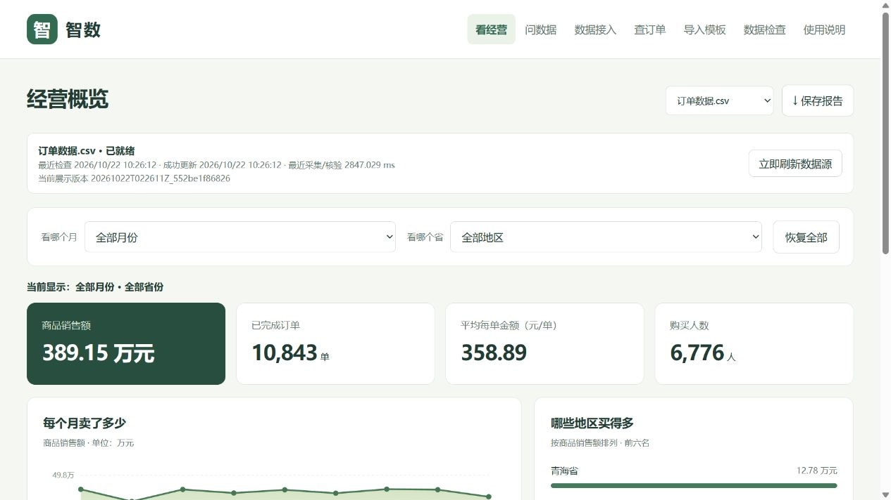
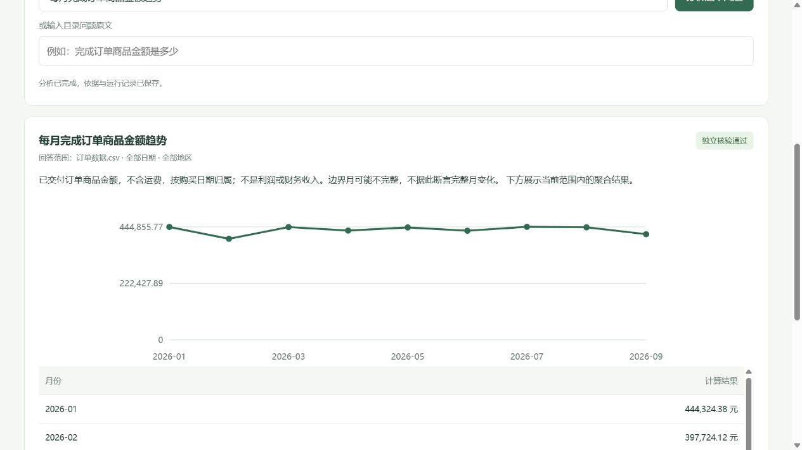
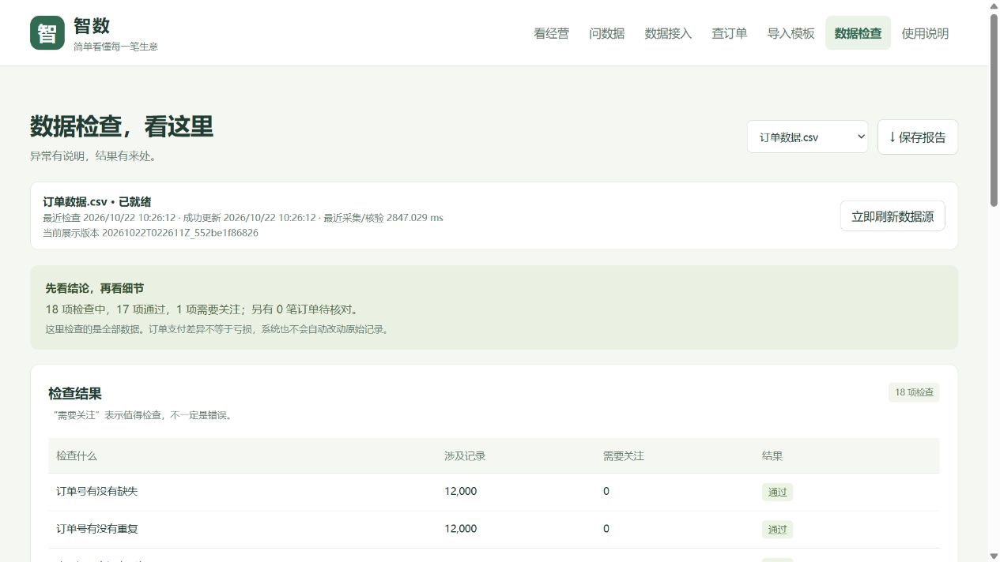

# 智数巡检 · 电商数据审计分析平台

一个在 Windows 本机运行的电商订单分析桌面应用。导入表格或连接关系数据库后，可查看经营指标、检查数据质量，并通过固定问题目录得到保留计算依据的分析结果。

**当前版本：v0.1.0** · Python 3.11 · DuckDB · 原生桌面窗口 · 离线固定问题问答

**个人开发者：** [shuoshuochen44-commits](https://github.com/shuoshuochen44-commits)。本项目由其个人开发与维护。

## 可以做什么

- **经营看板**：商品销售额、完成订单数、客单价、去重买家数，以及月份、地区、品类分析与完整月份环比。
- **数据接入**：读取 CSV、TSV、分隔 TXT、Excel、ODS、平面 JSON/JSONL、Parquet、SQLite 和 DuckDB 文件；预览表格并确认九个订单字段。
- **导入诊断**：建议复用相同列结构的已确认映射，定位错误行、字段和修改方法；最多展示 50 项，并统计完整错误数。
- **持续更新**：手动刷新、定时采集、变更轮询和页面推送；失败保留上次成功结果，每次成功变化保存独立快照。
- **可审计问答**：30 条固定问题目录，包含经营计算、质量检查、口径说明和明确拒答。回答保留 SQL、参数、来源、数据版本、独立核验和运行编号，可下载或重放。
- **订单与报告**：按编号、状态查询订单，导出 CSV，保存当前筛选范围的 HTML 报告。

本应用启动时为空工作区，数据由使用者自行选择。公开下载包附带的五份订单文件是独立生成的测试数据，不会自动导入。

## 界面预览

以下截图使用独立生成的测试订单，只展示界面与计算流程。



<details>
<summary>查看问答核验与数据检查界面</summary>





</details>

## 下载 Windows 桌面版

打开本仓库的 [Releases](https://github.com/shuoshuochen44-commits/ecommerce-analytics-audit/releases)，下载 Windows 压缩包并完整解压，然后双击 `智数巡检.exe`。关闭窗口即停止该应用的后台服务，重复启动会恢复已有窗口。

运行环境为 Windows 和 Edge WebView2 Runtime。源码和命令行分析也可独立使用；其他操作系统的桌面界面未验收。

1. 进入“数据接入”，选择文件或填写数据库连接。
2. 选择来源表，确认字段映射，点击“检查映射后数据”。
3. 确认订单粒度与人民币口径后导入，在“看经营”中选择月份和地区。
4. 进入“问数据”选择问题，查看结果、图表和计算依据。

完整接入说明见 [数据连接与更新](docs/data-connections.md)，问答边界见 [可审计问答](docs/auditable-analysis.md)。

## 从源码启动

以下命令在克隆后的仓库根目录执行，使用 Python 3.11。Windows PowerShell 示例：

```powershell
git clone https://github.com/shuoshuochen44-commits/ecommerce-analytics-audit.git
cd ecommerce-analytics-audit
python -m venv .venv
.\.venv\Scripts\python.exe -m pip install -r requirements-lock.txt
.\.venv\Scripts\python.exe -m pip install --no-deps --no-build-isolation -e .
.\.venv\Scripts\python.exe -m zhishu_inspection.desktop
```

默认工作区位于仓库中的 `workspace/`，不会进入 Git。可以自行指定位置：

```powershell
.\.venv\Scripts\python.exe -m zhishu_inspection.desktop --data-dir work/my-workspace
```

`requirements-lock.txt` 固定已验证的直接依赖，传递依赖由安装器解析，不是完整的跨平台锁文件。数据库驱动和 Windows 桌面依赖也包含在该文件中。

只运行本机 HTTP 服务时，可使用兼容入口；服务仅监听本机：

```powershell
.\.venv\Scripts\python.exe -m zhishu_inspection.launcher --no-browser --data-dir work/my-workspace --port 8765
```

## 生成可导入文件

不需要下载真实业务数据即可体验。以下命令生成五份内容相同的独立订单文件，每份 12,000 笔，覆盖 2026 年 1—9 月：

```powershell
.\.venv\Scripts\python.exe scripts/export_import_samples.py work/import-samples
```

生成格式为 CSV、XLSX、JSON、Parquet 和 SQLite。任选一份手动导入即可；脚本拒绝覆盖已有同名文件。它们是确定性生成的测试订单，不代表真实交易或市场情况。

## 分析如何核验


每个回答绑定提交时的数据来源、成功快照和筛选条件。独立复算使用原始表与 Python/Decimal，避免复用同一段聚合 SQL 作为“核验”。数据更新不会悄悄改写已保存的回答。无法核验的结果明确阻止展示业务数字。

SQL 网关通过解析器约束单条只读查询、获准表列、函数、超时和返回数量。系统不提供任意 SQL 执行或源数据修改入口。

## 当前支持范围

| 项目 | 已实现范围 |
|---|---|
| 订单模型 | 每行一笔完整订单、一个汇总品类、九个业务字段、人民币金额 |
| 文件限额 | 源文件及展开表格分别最多 20 MB；最多 20,000 行、200 列；规范化 CSV 最多 5 MB |
| 本地数据库 | SQLite、DuckDB 已实际验证读取与数据变化 |
| 网络数据库 | MySQL/MariaDB、PostgreSQL、SQL Server、Oracle 驱动已打包；真实服务器连接尚未验收 |
| 更新方式 | 全量快照采集；10—3600 秒定时采集，或 1—30 秒变更轮询后推送页面 |
| 问答 | 30 条目录问题精确匹配，未接入大模型或泛化自然语言理解 |
| 数据版本 | 成功快照、来源指纹、分析记录、按原版本重放 |

轮询间隔不等于端到端延迟保证，当前不是日志增量 CDC。尚未实现多表自动关联、任意业务建模、嵌套 JSON 展开、PDF/Word 提取、图片 OCR 或 NoSQL。

订单汇总导入不包含真实商品编号，因此商品编号排名会拒答，品类排名可用。缺少成本、费用或交付日期时，不推断利润与物流时效。商品销售额不是财务收入。

数据库密码仅保存在当前进程内存，重启后重新填写。历史快照持续保留，应预留磁盘空间。

## 运行测试

```powershell
.\.venv\Scripts\python.exe -m pytest
node --test tests/analysis_ui.test.cjs tests/connections_ui.test.cjs
.\.venv\Scripts\python.exe scripts/verify_analysis.py --fixture-gold
```

界面逻辑测试需要 Node.js 24。测试使用仓库内的小样本或临时生成的数据，不依赖外部生产数据库。最后一次桌面功能验收为 **362 项 Python 测试、15 项界面逻辑测试通过**，详见 [桌面验收记录](docs/desktop-optimization-acceptance.md)。自动测试配置位于 [.github/workflows/ci.yml](.github/workflows/ci.yml)。

这些是工程验收结果，不是大模型准确率、论文对照实验或真实经营效果。

## 构建桌面程序

在已安装源码依赖的 Windows 环境执行：

```powershell
.\.venv\Scripts\python.exe -m pip install -r requirements-build.txt
powershell -ExecutionPolicy Bypass -File scripts/build_desktop.ps1
```

产物位于 `work/desktop-dist/智数巡检.exe`。`scripts/verify_desktop.py` 可在独立空工作区验证冻结程序的文件导入、问答、趋势、重放和记录下载。

`scripts/package_desktop_delivery.py` 是早期浏览器演示包的历史脚本，依赖本地历史产物，不用于当前版本发布。

## 项目结构

```text
src/zhishu_inspection/      数据接入、分析、质量检查与桌面服务
src/zhishu_inspection/web/  桌面窗口内的界面资源
sql/                       建模、指标与对账 SQL
tests/                     测试与小型工程样本
scripts/                   构建、验收与独立样本生成
docs/                      模型、口径、实现边界和验收记录
```

原始 Olist 历史数据不随源码分发；来源与复现步骤见 [数据说明](data/README.md)。它的币种是 BRL，与人民币订单导入保持区分。

## 作者、许可与反馈

项目代码使用 [MIT 许可证](LICENSE)。第三方 XLSB 测试文件保留其 [上游 MIT 许可](tests/fixtures/file_formats/LICENSE-calamine-MIT.md)。原始外部数据的获取和使用遵循其发布方条件，另见 [第三方说明](THIRD_PARTY_NOTICES.md)。

提交问题或改进前请阅读 [贡献说明](CONTRIBUTING.md)。版本变化见 [CHANGELOG](CHANGELOG.md)。
